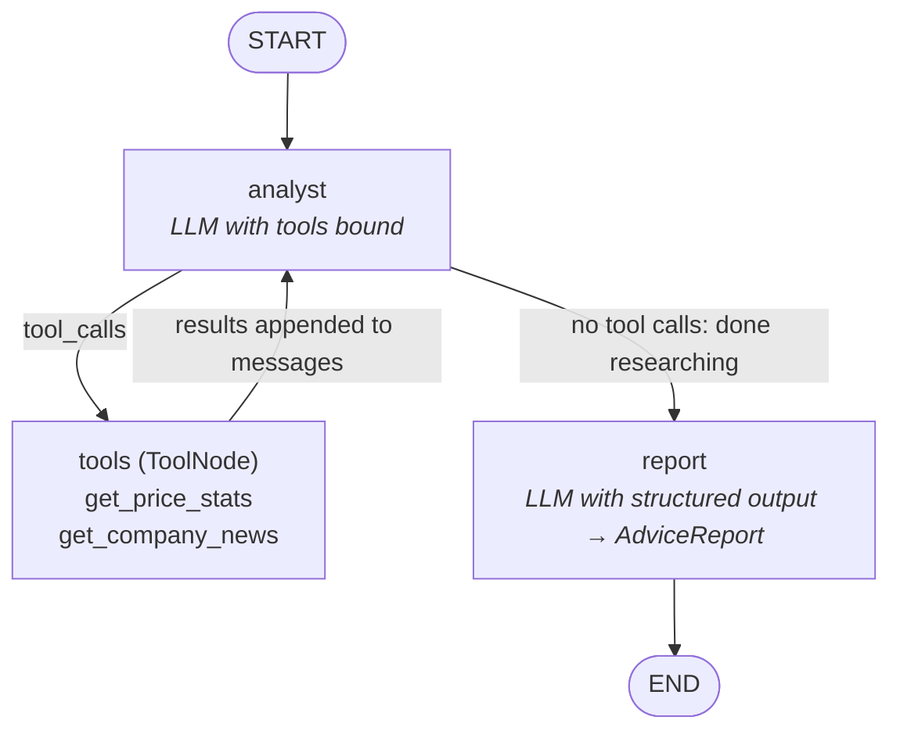

# FinancialAnalyst

An AI stock analyst built with **LangGraph** and a **local LLM** (Ollama). It pulls price stats and recent news for a ticker, reasons over them, and returns a structured buy/hold/sell report.

> Educational analysis based on public data, not personal financial advice.

## Setup

**1. Install Ollama and pull a model**

```bash
ollama pull gpt-oss:20b
```

**2. Create the environment and install requirements** (Python 3.12, using [uv](https://docs.astral.sh/uv/))

```bash
uv venv --python 3.12
```

```bash
source .venv/bin/activate
```

```bash
uv pip install -r requirements.txt
```

(Without uv: `python3.12 -m venv .venv && source .venv/bin/activate && pip install -r requirements.txt`)

**3. Configure**

```bash
cp .env.example .env
```

| Variable        | Default                  | What it does                              |
|-----------------|--------------------------|-------------------------------------------|
| `LLM_MODEL`     | `gpt-oss:20b`            | Ollama model name                         |
| `OLLAMA_URL`    | `http://localhost:11434` | Where Ollama is running                   |
| `LLM_NUM_CTX`   | `16384`                  | Context window (tool results are large)   |
| `LLM_REASONING` | `medium`                 | gpt-oss effort: `low` / `medium` / `high` |

## Usage

```bash
python main.py --ticker NVDA
```

```bash
python main.py --ticker KO --question "Is it a good defensive hold for the next 6 months?"
```

Options:

- `--ticker` (required): stock ticker, e.g. `NVDA`
- `--question`: your question in quotes (default: "Is this stock a reasonable buy right now?")
- `--max-steps`: safety cap on graph steps (default `20`)

The run prints each step live (which tool the analyst calls, how much data came back), then the final report as JSON:

```json
{
  "ticker": "KO",
  "recommendation": "hold",
  "rationale": "...",
  "evidences": [{"metric": "rsi_14", "value": 54.2, "meaning": "neutral momentum"}],
  "risks": ["..."],
  "confidence_level": 0.6,
  "disclaimer": "Educational analysis based on public data, not personal financial advice."
}
```

## How the graph works



1. **analyst** reads the question and decides which tools to call.
2. **tools** runs them: `get_price_stats` (prices, fundamentals, indicators via yfinance) and `get_company_news` (Yahoo + Google News headlines). Results go back to the analyst.
3. The loop repeats until the analyst stops asking for tools; then **report** turns the conversation into a validated `AdviceReport` (Pydantic).

Shared state (`AgentState`): `messages` (appended with `add_messages`), `ticker`, `question`, `report`.

## Project layout

```
main.py          CLI entry point, streams graph steps
app/graph.py     LangGraph state, nodes and edges
app/tools.py     market data + news tools
app/prompts.py   system prompts for analyst and report
app/schemas.py   AdviceReport / Evidence Pydantic models
app/config.py    LLM settings (read from .env)
```
